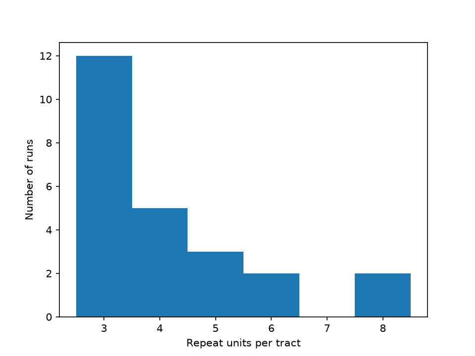
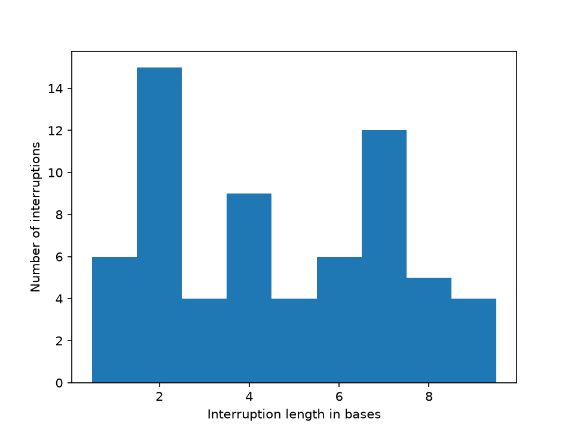

# Motif Repeat Scanner

## Definitions
**Motif** - A short sequence which will be scanned for run-on repeats
**Unit** – A single unit is the *motif* being scanned for (E.g, GAA)  
**Pure run** – A pure run refers to one or more *units* joined without interruption  
**max_gap** – The largest number of nucleotides which is accepted for *tract* joining.   
**Tract** – A tract is made up of one or more pure runs joined, each of which is at most *max_gap* nucleotides from the neighbouring pure run.   
**min_units** – A tract is discarded if the number of units in a given tract is less than *min_units*  

## Setup  
### Installing Requirements  
Install prerequisites:  
```python -m pip install -r requirements.txt```  
  
### Pytest
To sanity-check results, run ```pytest``` in the project directory, which checks the functions of the code against known answers, reporting an error if an unexpected answer is returned.    

## Usage
The only requisites for usage are a standard FASTA file containing genetic code, and the contents of requirements.txt.

In a terminal run:

```python motif_scanner.py path/to/file.fasta [-h] [--motif] [--max-gap [--min-unit] [--show-interruptions] [--plot]  ```


 ```**-h, --help**```           Shows help message and exit  
  ```--motif MOTIF```        Repeat motif of interest (default = GAA)  
 ```--max-gap MAX_GAP```    Largest gap between motifs in bases which is still accepted and joined (default = 9 bases)   
```--min-unit MIN_UNIT```   Minimum number of units in a tract to be reported (default = 3 units)  
```--show-interruptions```   Lists joined interruptions in the output         
  ```--plot```    Plots histogram of pure run length & interruption length. Will only plot interruptions if --show-interruptions is used.

The scanner will **automatically scan for the reverse complement of the motif.**  


## Output
The output will include:

### 1. Every tract found greater than ```min_units``` units long  

Each tract outputs the following information:  
```start:```   (Start coordinates of tract, 0 based)  
```end:```    (End coordinates of tract, ends at last base)  
```span:```   (Length of tract in bases)  
```units:```   (Number of motifs found)  
```longest pure run:```   (Highest number of motifs found with 0 interruptions)  
```reverse complement?:```  (Whether the tract is made up of the original motif or of its reverse complement)

```Joined interruptions present:```**[...]**  


### 2. Every joined interruption within a tract ```[--show-interruptions]```

Each joined interruption outputs the following information:
```"Interruption start":```    (Start coordinates of interruption)     
```"Interruption end"```   (End coordinates of iterruption)  
```"Interruption span":```   (Length of interruption in bases)  
```"sequence":```     (The interruption itself)  
```"multiple of 3?":```    (If the interruption length is divisible by 3)  
  
### 3. Histogram summarising data ```[--plot]```

Two separate histograms will be output, summarising the distribution of:
- Repeat units per tract
- Interruption length

PNG files of the histograms will be saved to the project folder.  
  
The following are sample histograms run on keratin.fasta, using default parameters for ```min-units``` and ```max-gap```, with ```--motif TC``` and ```--show-interruptions```:   
  
   


## Sample Output
This is a sample output run on a fasta file containing:  
**GAAGAAGAA** *C* **GAAGAAGAAGAAGAAGAAGAA** (spaced for visual clarity)
  
Based on the definitions above, there are:  
3 GAA **units** in a row with no interruption, i.e. a **pure run** of length 3  
1 C, an interruption of length 1  
7 GAA **units** (or pure run 7)    

>python motif_scanner.py sample.fasta --motif GAA --show-interruptions --plot
  
No ```max-gap``` parameter was specified, default = 9 bases
No ```min-unit``` parameter was specified, default = 3 units  

Output:
```TRACT #1  
start: 0  
end: 31  
span: 31  
units: 10  
longest pure run: 7  
reverse complement?: False   
 
-Joined interruptions present-   
  
Interruption start: 9  
Interruption end: 10  
Interruption span: 1  
sequence: C  
multiple of 3?: False   
```

## Known Issues

### 1. Overlap  
The current algorithm finds matches in:  
"ATATAATAATA"  
As:
```[(0,3), (5, 11)]```
Whereas the true match should be:  
```[(2,11)]```  
This is due to the algorithm currently not taking overlapping matches into consideration.   
A better algorithm is the primary focus of the project currently.
